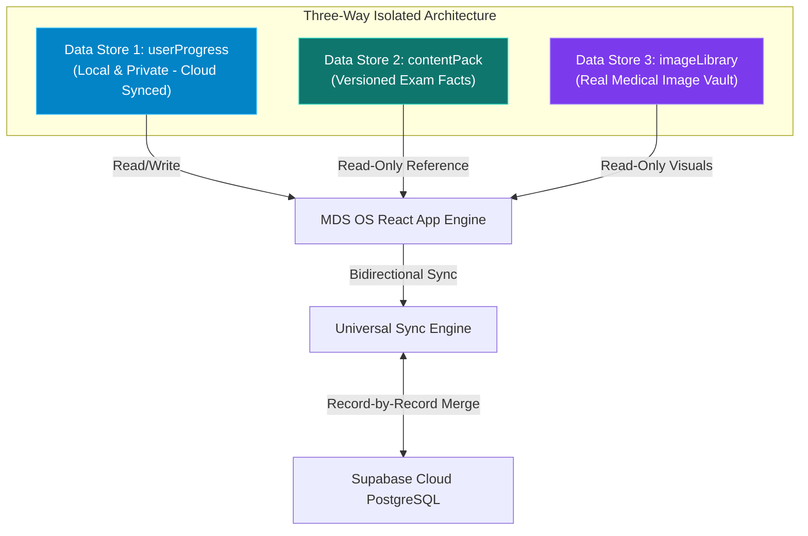

# 🦷 NEET-MDS Top-10 Planner (MDS OS) — AI Handover & Engineering Master Specification

> **Version:** `2026-11-15.Universal.V1`  
> **Target Exam:** NEET-MDS 2027 (with INI-CET alignment)  
> **Target Aspirant Goal:** All-India Rank 1–10 (AIR 1–10) • Target Specialty: Oral & Maxillofacial Surgery (OMFS)  
> **Preparation Schedule:** Full-Time Preparation (8 focused hours/day)  
> **Repository Path:** `/Users/jatinpawar/Downloads/MDS_Desktop_OS`  
> **Host Environment:** macOS (Universal Mac AppKit + Cross-Platform PWA/Web)

---

## 1. Executive Summary & Core Mission

**MDS OS** is an offline-first, Apple Human Interface Guidelines (HIG)-inspired daily study command center and clinical operating system designed specifically for a dental graduate preparing full-time (8 hours/day) for NEET-MDS 2027.

The application serves three distinct preparation requirements:
1. **Daily Operational Discipline:** Strict 8-hour timeblocked study rhythm, daily diagnostic testing, dynamic progress tracking, and Leitner spaced-repetition mistake logging.
2. **Strict Exam Simulation:** Timed CBT mock simulator strictly replicating official NBEMS rules—specifically the **unforgiving 75-minute Part A Lock** and **105-minute Part B session** with $+4 / -1$ scoring.
3. **Clinical & Institutional Decision Hub:** Integrated database of all 16 AIQ Government Dental Colleges, branch-wise cut-offs, Year 1–3 stipends, bonds, 3-year net residency ROI calculator, and an "After the Result" counselling tracker with 2026 Freeze/Float rules.

---

## 2. Directory Structure & File Inventory

The entire workstation is self-contained in `/Users/jatinpawar/Downloads/MDS_Desktop_OS`:

```text
/Users/jatinpawar/Downloads/MDS_Desktop_OS/
├── index.html                  # Apple HIG layout, CSS variables, glass materials, ambient canvas
├── app.jsx                     # Complete React 18 frontend source (3,360+ lines)
├── app.js                      # Babel-compiled production bundle (~182 KB, zero runtime build step)
├── sw.js                       # Service Worker: offline caching, stale-while-revalidate
├── manifest.json               # PWA configuration: icons, shortcuts, standalone display
├── launch.sh                   # Self-contained zero-dependency startup script (Mac + Web)
├── serve_sync.py               # Python 3 server: sync bridge + /api/update-proxy + /api/ip
├── package_desktop_app.sh      # Swift AppKit compiler & codesigning script
├── MDS_Desktop_OS.app/         # Native macOS Application bundle (AppKit frameless window)
│   └── Contents/
│       ├── MacOS/MDS_Desktop_OS# Compiled Swift executable
│       ├── Resources/          # Bundled web assets (app.js, index.html, vendor scripts)
│       └── Info.plist          # App metadata & URL schemes
├── api/
│   └── update-proxy.js         # Node.js / Vercel Serverless proxy for NBEMS/MCC/DCI live fetch
├── supabase/
│   └── schema.sql              # Supabase PostgreSQL DDL, RLS policies, Realtime, snapshot triggers
├── js/
│   ├── sync_engine.js          # Universal offline-first sync engine with 9 self-tests
│   ├── content_pack.js         # Store 2: Versioned exam facts (2026 baseline, 17 subjects)
│   ├── image_library.js        # Store 3: Real-photo medical image vault with licenses & credits
│   └── study_data.js           # 23-Week schedule, 16 hidden exam rules, 5 master checklists
└── vendor/                     # Offline local vendor fallbacks
    ├── react.min.js            # React 18 production UMD
    ├── react-dom.min.js        # ReactDOM 18 production UMD
    ├── supabase.min.js         # Supabase JS Client v2 UMD
    └── tailwindcss.js          # Tailwind CSS standalone runtime
```

---

## 3. The Three-Way Isolated Data Store Architecture

To guarantee that future official syllabus updates or bugfixes never overwrite or corrupt the student's study data, data is segregated into three strictly independent stores:



### 1. `userProgress` (Private, Editable, Synced)
- Holds user-generated data: 8-hour daily routine checkboxes, study streak, 23-week plan checkboxes, 17-subject confidence levels (0–10), MCQ counters, mock test logs, mistake notebooks, college shortlist, counselling milestones, and state quota notes.
- **Rule:** Every scalar field is normalized to `{ value, updatedAt }` for deterministic last-write-wins merge. Updates to `contentPack` or `imageLibrary` **never touch** `userProgress`.

### 2. `contentPack` (Versioned Exam Facts)
- Hardcoded baseline: Version `2026-11-15.1`.
- Contains official NBEMS pattern, subject weightage (Part A 100 Qs / Part B 140 Qs), scoring rules (+4 / -1), historical top-10 cut-offs (AIR 1: 802, AIR 10: 765), volatile numbers, guessing EV math, and OMFS closing ranks.
- Read-only to the user. Updated via versioned releases or live updates via `/api/update-proxy`.

### 3. `imageLibrary` (Zero-AI Medical Image Vault)
- **Strict No-AI Policy:** Real medical clinical photographs, histopathology slides, and radiographs only.
- Every entry carries verified medical attribution: diagnosis, subject, institution/source, author, license (CC BY / CC BY-SA / Public Domain), and original URL.

---

## 4. Complete Inventory of All 15 Screens Built

| Screen ID | Navigation Label | Core Functionality & Features |
|---|---|---|
| `dashboard` | **Today** | Daily Command Center: 8-hour routine checklists, streak counter, exam countdown ("NEET-MDS 2027 — not announced yet"), quick-start diagnostic quiz, and high-yield cards. |
| `plan` | **23-Week Plan** | 4-Phase study roadmap (Phase 1: First Pass, Phase 2: Integration, Phase 3: Revision, Phase 4: Final Taper). Weekly topic breakdown and hours tracking. |
| `curriculum` | **17 Subjects** | Comprehensive curriculum matrix: Part A / Part B tags, question weights (~14–15 Qs/subject), interactive confidence sliders (0–10), error tallies, and textbook anchors. |
| `cbt_mock` | **CBT Simulator** | **Strict NBEMS Part A 75-min Lock**: when 75 min expires or on submission, Part A permanently locks (`cbtPartALocked: true`) and transitions to Part B (105 min, 140 Qs). +4/-1 scoring, review palette, and pace calculator. |
| `daily_quiz` | **Daily Quiz** | 30-Question high-yield pool with deterministic pseudo-random daily 10-question selection. Prioritizes weak subjects (PHD & Physio/Biochem). Instant rationales and "Add missed to Mistake Log" CTA. |
| `error_log` | **Mistake Log** | Error log categorized into 5 root causes (Concept Gap, Silly/Misread, Time Pressure, Guess Failed, Image Misread). Built-in Leitner spaced repetition (+2d, +7d, +21d review dates). |
| `volatile_vault`| **Volatile Formulas**| High-yield memorization sheet: Malamed LA max doses, adrenaline ceilings, fluoride toxic doses (PTD/STD/CLD), Steiner/Downs cephalometrics, Gypsum W:P ratios, amalgam phases, and tooth eruption sequences. |
| `ibq_spotter` | **Real Image Atlas** | Visual diagnostic trainer: radiographs (OPG, intraoral), histopathology slides (ameloblastoma, OKC), clinical photos. Includes pan-zoom lightbox and timed 15-image diagnostic drill. |
| `omfs_deep_dive`| **OMFS Deep Dive** | Deep dive into target specialty: Pederson Difficulty Index calculator, Winter's lines, fracture classifications (Le Fort I-III, Champy miniplates), space infections (Ludwig's angina), nerve injury rules, and AIQ closing ranks. |
| `colleges` | **Colleges & Shortlist**| 16 AIQ Government dental colleges + deemed institutions. Closing ranks (2025/2026), monthly stipends (Yr 1–3), annual fees, bond penalties. Interactive reorderable preference builder. |
| `after_result` | **After Result Hub** | Historical score-to-rank estimator, 3-year net stipend vs fee ROI calculator (+₹41L surplus vs -₹26L deficit), 2026 Freeze vs Float decision helper, round-by-round counselling tracker, and document checklist. |
| `hidden_neglected`| **16 Hidden Rules** | Official technical rules students routinely miss: NDA/no answer key penalties, BDS aggregate % form verification trap, J&K AIQ restrictions, PwD board deadlines, and dress code realities. |
| `watchlists` | **Master Checklists** | Pre-exam verification checklists: biometric compliance, photo/signature dimensions, admit card preservation rules, and exam-day carry kit. |
| `update_centre` | **Update Centre** | Live fetcher for NBEMS, MCC, and DCI. Discloses live HTTP status, handles Cloudflare challenges with honest "Manual check needed" status, and provides direct official portal links. |
| `settings` | **Settings & Sync** | Supabase Project URL and Anon Key configuration, Realtime connection toggle, conflict inspector, last-3 rollback snapshots, data export/import (JSON), Light/Dark/System theme toggle, and sync test runner. |

---

## 5. Offline-First Cloud Synchronization Engine

The synchronization engine in `js/sync_engine.js` was engineered to handle bidirectional synchronization between multiple devices without data loss:

### 1. Scalar Normalization & Field Timestamps
Every scalar field is stored as an object:
```javascript
{
  value: rawValue,
  updatedAt: "2026-11-15T18:24:00.000Z"
}
```

### 2. Three-Way Record Merging Logic
When merging Local (`L`) and Cloud (`C`) state:
- If `L` does not exist $\implies$ adopt `C`.
- If `C` does not exist $\implies$ adopt `L`.
- If both exist: compare `updatedAt`. The later timestamp wins.
- If a conflict occurs on an active entity, the losing record is preserved in `syncConflicts` so the user can inspect or revert it.

### 3. Tombstone Deletion Model
Items deleted locally are marked with `_deleted: true` and `deletedAt: ISOString`. This prevents deleted items from being resurrected by cloud sync. Tombstones are purged after 30 days.

### 4. Verified Self-Test Suite (All 9 Passed)
`SyncEngine.runSelfTests()` can be executed in Node or the browser console:
- **Test 1:** Mock test logged on Device A propagates to Device B with identical score (786).
- **Test 2:** Subject confidence changes and error entries on B merge cleanly into A.
- **Test 3:** Independent offline additions on both devices both survive without clobbering.
- **Test 4A:** Later edit wins deterministically.
- **Test 4B:** Losing edit is preserved in `syncConflicts`.
- **Test 5:** Tombstone deletion wins against older cloud records and prevents resurrection.
- **Test 6:** Active roundtrip write/read check against `localStorage` verifying deep payload equality.
- **Test 7:** Offline local progress merges into cloud data smoothly.
- **Test 8:** Fresh client installation successfully downloads complete cloud profile.

---

## 6. Mathematical Models & Clinical Formulations

### 1. Guessing Expected Value Equation
For $+4$ correct, $-1$ incorrect, and $0$ unattempted:
$$\mathbb{E}[X] = 4p - 1(1-p) = 5p - 1$$
- Pure random guess (4 options, $p=0.25$): $\mathbb{E}[X] = 5(0.25) - 1 = +0.25$
- 1 Option eliminated ($p=0.333$): $\mathbb{E}[X] = 5(0.333) - 1 = +0.67$
- 2 Options eliminated (50:50, $p=0.50$): $\mathbb{E}[X] = 5(0.50) - 1 = +1.50$

> **Top-10 Operational Rule:** Attempt questions where $\ge 1$ (ideally 2) options are eliminated. Skip pure blind guesses to avoid accumulating incorrect answers that degrade tie-breaking criteria (a) and (c).

### 2. Pederson Difficulty Index for Mandibular 3rd Molar Impaction
$$\text{Total Difficulty Score} = \text{Angulation} + \text{Depth} + \text{Ramus Relationship}$$
- **Angulation:** Mesioangular (1), Horizontal (2), Vertical (3), Distoangular (4).
- **Depth (Pell & Gregory):** Level A (1), Level B (2), Level C (3).
- **Ramus Relationship:** Class I (1), Class II (2), Class III (3).
- **Interpretation:** 3–4 = Easy; 5–6 = Moderate; 7–10 = Very Difficult.

### 3. 3-Year Residency Net Financial Return
$$\text{Net Return} = \sum_{y=1}^{3} (\text{Monthly Stipend}_y \times 12) - \text{Total Course Fee}$$
- **MAIDS:** $(\text{₹}1,15,003 \times 36) - \text{₹}39,000 = +\text{₹}41,01,108$
- **KGMU:** $(\text{₹}1,09,955 + \text{₹}1,12,994 + \text{₹}1,16,034) \times 12 - \text{₹}1,64,000 = +\text{₹}39,03,796$
- **Deemed (KIDS):** $(\text{₹}49\text{k} + \text{₹}51\text{k} + \text{₹}53\text{k}) \times 12 - \text{₹}45,00,000 = -\text{₹}26,64,000$

---

## 7. Open Questions & Edge Cases for NEET-MDS 2027

Any subsequent AI or engineer working on this codebase must be aware of the following unconfirmed variables:

1. **Internship Cut-Off Date Uncertainty:**
   - The user's expected internship completion is **early May 2027**.
   - In 2026, the cutoff was **31 May 2026** (user provisionally eligible).
   - In 2025, the initial cutoff was **31 March 2025** (which would render user ineligible unless extended by MoHFW).
   - **Action for next AI:** The day the 2027 NBEMS Information Bulletin is published, verify the internship cutoff clause immediately and update `contentPack.js`.

2. **Cloudflare Challenges on NBEMS:**
   - `natboard.edu.in` utilizes Cloudflare WAF which returns HTTP 403 when scraped via automated HTTP clients.
   - The `/api/update-proxy` currently detects this cleanly and returns `"status": "blocked", "statusText": "Manual check needed"`.
   - Do not attempt to bypass this with headless browsers or CAPTCHA solvers; maintain honest status reporting and direct portal links.

3. **No Hardcoded State Quota:**
   - Domicile rules, bonds, and portals vary widely between states (UP DGME, Maharashtra CET CELL, Karnataka KEA, TN Medical Selection).
   - The app deliberately prompts the student to enter their own state details rather than assuming one.

---

## 8. Prioritized Roadmap for the Next AI / Engineer

If tasked with continuing development on this project, prioritize improvements in this exact order:

### Priority 1: CBT Mock Question Pool Expansion
- **Current State:** Part A has sample questions; the timer and Part A 75-minute lock engine are fully operational.
- **Task:** Expand `CBT_PART_A_MOCK_QUESTIONS` to a full 100 questions and `CBT_PART_B_MOCK_QUESTIONS` to a full 140 questions, maintaining strictly verified medical content and standard textbook citations.

### Priority 2: Interactive SVG Cephalometric Tracing Visualizer
- **Current State:** Steiner, Downs, Tweed, and Ricketts norms are listed in `volatile_vault`.
- **Task:** Build an interactive SVG cephalometric canvas inside Screen 7 or Screen 8 where students can adjust Nasion, Sella, Point A, and Point B points to see ANB angle change between Class I, Class II, and Class III interactively.

### Priority 3: Offline Audio Metronome / 45-Second Pacing Audio Cue
- **Current State:** Visual pace indicator indicates whether the student is ahead of or behind the 45-second schedule.
- **Task:** Add an optional subtle Web Audio click/chime at the 45-second mark during mock tests to train sub-conscious time awareness for CBT conditioning.

### Priority 4: Web Bluetooth / USB Export for Hospital Duty Devices
- **Current State:** Cloud sync requires Supabase; manual transfer uses JSON export/import.
- **Task:** Add a 1-click QR-code data transfer generator in Settings that encodes encrypted diffs for instant scanning by mobile cameras without requiring Wi-Fi pairing.

---

## 9. Verification & Build Commands

To re-verify the codebase at any time, run:

```bash
# 1. Verify zero curly quotes across codebase
python3 -c "import glob; chars=['\u2018','\u2019','\u201c','\u201d']; [print(f'Curly quote in {p}') for p in glob.glob('/Users/jatinpawar/Downloads/MDS_Desktop_OS/**/*', recursive=True) if p.endswith(('.js','.jsx','.html','.css','.sql','.sh','.py')) and any(c in open(p, errors='ignore').read() for c in chars)]"

# 2. Compile app.jsx to app.js
node -e "
const fs = require('fs');
const vm = require('vm');
const sandbox = { window: {}, console: console };
vm.createContext(sandbox);
vm.runInContext(fs.readFileSync('/tmp/babel.min.js', 'utf8'), sandbox);
const Babel = sandbox.Babel || sandbox.window.Babel;
const result = Babel.transform(fs.readFileSync('/Users/jatinpawar/Downloads/MDS_Desktop_OS/app.jsx', 'utf8'), { presets: [['react', { runtime: 'classic' }]], filename: 'app.jsx' });
fs.writeFileSync('/Users/jatinpawar/Downloads/MDS_Desktop_OS/app.js', result.code, 'utf8');
console.log('Compiled app.js. Size:', result.code.length);
"

# 3. Check JS syntax
node --check /Users/jatinpawar/Downloads/MDS_Desktop_OS/app.js
node --check /Users/jatinpawar/Downloads/MDS_Desktop_OS/js/sync_engine.js

# 4. Run Sync Self-Tests
node -e "
const storage = {};
global.localStorage = { getItem: (k) => storage[k] || null, setItem: (k, v) => { storage[k] = String(v); }, removeItem: (k) => { delete storage[k]; }, clear: () => {} };
global.window = global;
require('/Users/jatinpawar/Downloads/MDS_Desktop_OS/js/sync_engine.js');
console.log('Sync Tests:', window.SyncEngine.runSelfTests().map(t => t.test + ': ' + t.passed).join('\n'));
"

# 5. Package and Sign native macOS App
cd /Users/jatinpawar/Downloads/MDS_Desktop_OS && ./package_desktop_app.sh
```
